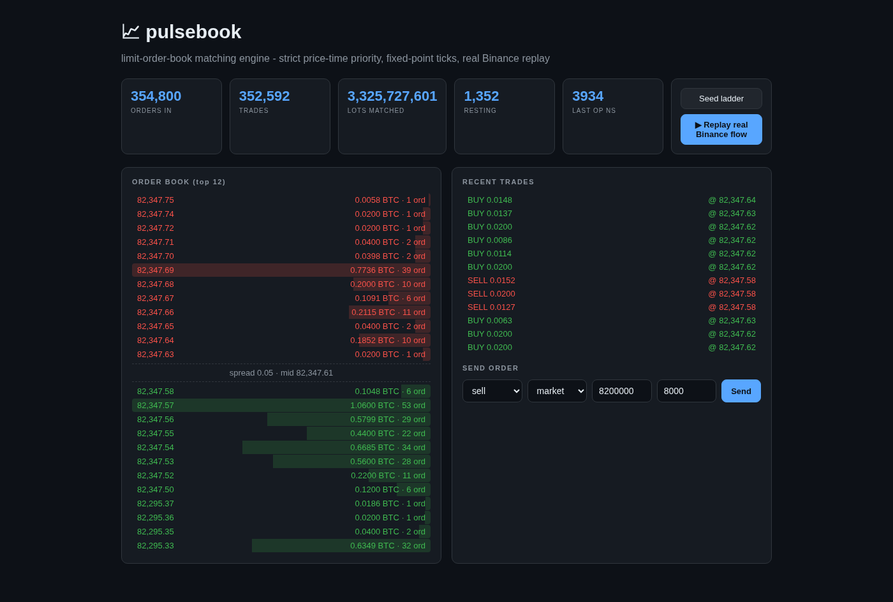

# pulsebook

A central limit order book matching engine with strict price-time priority -
the same matching model Binance, NYSE and every modern exchange run - in Go,
with fixed-point integer prices (no floating point near money), validated
against real Binance BTCUSDT order flow.

**Demo video:** see `demo/pulsebook-demo.mp4` (Drive mirror linked below)
**Report:** `docs/report/REPORT.pdf`



## What it does

- Limit and market (IOC) orders, cancel, partial fills, book walking
- **Price-time priority**: best price first; within a level, FIFO by arrival
- Trades always print at the **resting (maker) order's price**
- Prices are int64 ticks, quantities int64 lots - exact arithmetic only
- Invariant checker (`CheckInvariants`): uncrossed book, sorted levels,
  time-ordered queues, no zero-quantity orders - run after every op in tests
  and after real-data replays
- **Real-data validation**: replays the actual Binance BTCUSDT aggTrades dump
  (689,545 aggressor trades from 2026-10-19, public data.binance.vision
  archive) through the engine as market-order flow against a live book
- Live dashboard: depth ladder, recent prints, order entry, one-click replay

## Measured performance

Single goroutine, sequential calls, in-process engine API (no HTTP), fixed
seed, linux/amd64, Go 1.26.6. Reproduce with `go run ./cmd/bench`
(writes `benchmarks.json`).

| Operation | Cost | Throughput |
|---|---|---|
| Limit insert (resting) | 429 ns/op | 2.33M orders/s |
| Cancel | 162 ns/op | 6.16M cancels/s |
| Matching (crossing order) | 1,589 ns/op | 0.63M orders/s, 198k trades |
| **Real Binance replay** | - | 100,000 real aggressor trades + ~190k events in 0.16s = **1.03M events/s**, 164,339 executions, invariants held |

Data source: https://data.binance.vision/data/spot/daily/aggTrades/BTCUSDT/BTCUSDT-aggTrades-2026-10-19.zip

## Run it

```bash
# download a real day of Binance flow first (any date works):
curl -O https://data.binance.vision/data/spot/daily/aggTrades/BTCUSDT/BTCUSDT-aggTrades-2026-10-19.zip
unzip BTCUSDT-aggTrades-2026-10-19.zip -d data/

go run ./cmd/server            # dashboard on http://localhost:8092
go test -race ./pb/            # 10 tests incl. 20k-op invariant fuzz
go run ./cmd/bench             # reproduces the numbers above
```

## Design notes

- Levels live in sorted int64 slices per side (binary search + insert);
  orders inside a level live in a doubly-linked FIFO queue. Cancel is O(1)
  via the order's element pointer
- The replay harness plays the role of a market maker between real aggressor
  trades: it keeps ~1 BTC of liquidity near the touch and rebuilds a side's
  ladder if it empties, so a full day of flow never leaves the book one-sided

## Honest notes

- Single instrument, single goroutine - production exchanges shard by symbol;
  the matching core is the same either way
- Level storage is slice-based; a red-black tree or intrusive arena allocator
  is the next lever for books with thousands of active levels
- The replay validates matching semantics against real flow; it is not a
  backtest (no queue position modeling, no latency model)
- Benchmarks are sequential by design (sandbox loopback throttles concurrent
  HTTP), single-machine numbers
